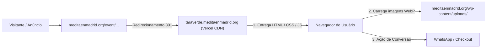

# Plano de Implementação e Arquitetura · Landing Page Tara Verde
**Projeto:** Iniciación de Tara Verde · KMC Madrid  
**Domínio Oficial:** [https://meditaenmadrid.org/](https://meditaenmadrid.org/)  
**URL Atual do Evento (Origem):** `https://meditaenmadrid.org/event/iniciacion-de-tara-verde-con-kelsang-chojung/`  

---

## 1. Diagnóstico e Decisão Arquitetural

### O dilema: Elementor vs. Vercel (Edge Estático)
* **Por que evitar o Elementor para esta Landing Page de Alta Conversão:**
  * **Sobrecarga de Scripts e CSS:** O Elementor carrega bibliotecas genéricas (jQuery, widgets internos, dezenas de folhas de estilo e wrappers HTML profundos).
  * **Queda nos Core Web Vitals:** No tráfego pago e em conexões móveis na Espanha (3G/4G/5G), páginas no Elementor costumam ter um tempo de carregamento perceptível de 2.5 a 4.5 segundos. Cada segundo extra reduz a conversão em média 7% a 15%.
  * **Conflitos de Cache e Plugins:** O WordPress da instituição já possui plugins ativos pesados (The Events Calendar Pro, etc.), aumentando o risco de render-blocking.

* **Por que a Vercel (Edge CDN Global) é a Solução Ideal:**
  * **Desempenho Extremo (TTFB < 50ms):** Código HTML5/CSS3/JS puro sem banco de dados intermediário, entregue diretamente pelos nós da Vercel na Europa (Madrid/Frankfurt/Londres).
  * **Fidelidade Total ao Design System:** O código desenvolvido já contempla o layout split, responsividade personalizada, Google Icons e regras tipográficas refinadas.
  * **Estabilidade e Isolamento:** Se o WordPress passar por manutenção, atualização ou sobrecarga no calendário, a Landing Page continua funcionando sem nenhuma interrupção.

---

## 2. Visão Geral da Arquitetura



---

## 3. Plano de Ação Passo a Passo

### Fase 1: Hospedagem das Imagens no WordPress
Como o objetivo é centralizar o armazenamento de mídia na instalação existente do WordPress:

1. Acessar o painel administrativo do WordPress em **`Mídia > Adicionar novo arquivo de mídia`**.
2. Fazer upload dos 4 arquivos otimizados gerados no projeto:
   * `tara-verde-poster.webp` *(Poster oficial com auréola)*
   * `tara-verde-art.webp` *(Ilustração tradicional sem borda branca)*
   * `kelsang-chojung.webp` *(Foto recortada com transparência)*
   * `logo-kmc.webp` *(Logotipo institucional limpo)*
3. Anotar as URLs absolutas geradas pelo WordPress (exemplo):
   * `https://meditaenmadrid.org/wp-content/uploads/2026/11/tara-verde-poster.webp`
   * `https://meditaenmadrid.org/wp-content/uploads/2026/11/tara-verde-art.webp`
   * `https://meditaenmadrid.org/wp-content/uploads/2026/11/kelsang-chojung.webp`
   * `https://meditaenmadrid.org/wp-content/uploads/2026/11/logo-kmc.webp`
4. Substituir as referências locais no arquivo `index.html` pelas URLs definitivas do WordPress.

---

### Fase 2: Publicação e Domínio na Vercel

#### Opções de URL de Destino:
* **Opção Recomendada (Subdomínio Institucional):** `https://taraverde.meditaenmadrid.org/`
  * Transmite máxima confiança e consistência de marca ao público da Espanha.
* **Opção Direta (Vercel):** `https://tara-verde-madrid.vercel.app/`

#### Passos para Deploy:
1. Criar um repositório no GitHub para o projeto ou fazer deploy direto via terminal usando a **Vercel CLI** (`vercel`).
2. Configurações do projeto na Vercel:
   * **Framework Preset:** `Other` (HTML estático).
   * **Root Directory:** `./`
3. Configuração do Subdomínio (se aplicável):
   * No painel da Vercel: `Project Settings > Domains` > Inserir `taraverde.meditaenmadrid.org`.
   * No gerenciador DNS do domínio `meditaenmadrid.org` (Cloudflare, cPanel, Hostinger, etc.):
     * **Tipo:** `CNAME`
     * **Nome / Host:** `taraverde`
     * **Destino / Valor:** `cname.vercel-dns.com`
     * **TTL:** Automático ou 300 segundos.
   * O certificado SSL (HTTPS) é emitido e renovado de forma 100% automática e gratuita pela Vercel.

---

### Fase 3: Redirecionamento 301 da URL Antiga

Para garantir que acessos orgânicos, links existentes no site e tráfego prévio cheguem à nova Landing Page:

#### Método A: Via Plugin no WordPress (Mais Simples)
1. Instalar e ativar o plugin gratuito **Redirection** (ou usar a aba de redirecionamentos do Yoast SEO / Rank Math, se já instalados).
2. Adicionar nova regra:
   * **URL de Origem:** `/event/iniciacion-de-tara-verde-con-kelsang-chojung/`
   * **URL de Destino:** `https://taraverde.meditaenmadrid.org/` (ou URL da Vercel)
   * **Código de Status:** `301 - Movido permanentemente`
3. Salvar e testar o acesso à URL antiga no navegador (em modo anônimo).

#### Método B: Via `.htaccess` (Servidores Apache / LiteSpeed)
Caso queira máxima velocidade de redirecionamento antes de carregar o core do WordPress:
```apache
Redirect 301 /event/iniciacion-de-tara-verde-con-kelsang-chojung/ https://taraverde.meditaenmadrid.org/
```

---

## 4. Checklist de Validação Pré-Lançamento

- [ ] Imagens enviadas para o WordPress e URLs absolutas inseridas no `index.html`.
- [ ] Deploy na Vercel concluído e página acessível via HTTPS.
- [ ] Subdomínio DNS validado e propagado.
- [ ] Redirecionamento 301 testado a partir de desktop e mobile.
- [ ] Teste de clique nos botões de CTA (`Reservar plaza` e link de WhatsApp `699 11 08 39`).
- [ ] Verificação de velocidade no Google PageSpeed Insights (meta: 95+ no Mobile).

